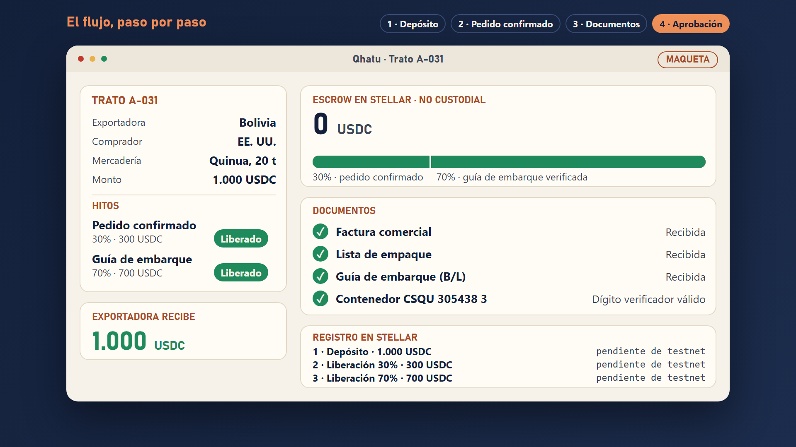

# Qhatu

**Tu proveedor cobra cuando cumple.**

Pagos condicionados por hitos, en dólares digitales, para pymes que compran y venden al exterior. Autoservicio, sobre Stellar. *Qhatu* significa «mercado» en quechua.

> **Estado: idea y maqueta.** No hay producto en mainnet ni transacciones reales en testnet todavía. Qué existe y qué no está en [estado y límites](docs/estado-y-limites.md).

**In English.** Qhatu is a milestone-based payment flow for small businesses that trade across borders. The buyer deposits 100% in a non-custodial escrow on Stellar before production starts. The funds are released in two milestones as documents are checked: 30% when the order is confirmed and 70% against a verified bill of lading. It is meant to be built on top of Trustless Work (escrow) and Pollar (sign-in without crypto). It is at the idea and mockup stage. Made for the Ideatón Stellar Bolivia 2026, Payments and remittances track.

## El problema

En una venta al exterior, alguien paga a ciegas: el comprador no quiere pagar por adelantado a un proveedor que nunca vio, y el proveedor no quiere despachar sin saber si le van a pagar.

- En Bolivia, las operaciones con activos virtuales pasaron de 46,5 a 294 millones de dólares entre el primer semestre de 2024 y el de 2025 (BCB).
- En el mundo, la brecha de financiamiento al comercio es de 2,5 billones de dólares, y a las pymes les rechazan el 41% de las solicitudes (Banco Asiático de Desarrollo, enero de 2026).

## Cómo funciona

1. **Trato con link.** El exportador define monto, hitos y documentos, y le manda el link a su comprador.
2. **Depósito en escrow.** El comprador deposita el 100% en USDC, en un escrow no custodial en Stellar, antes de producir.
3. **Documentos verificados.** Reglas revisan que los documentos cuadren y que el contenedor exista (dígito verificador ISO 6346 y seguimiento de la naviera).
4. **Pago por hitos.** 30% al confirmar el pedido y 70% contra la guía de embarque verificada. Si hay un reclamo, decide un tercero independiente.

Qhatu nunca controla la plata. Más en [estado y límites](docs/estado-y-limites.md).

## Qué hay en este repo

| Carpeta | Qué es |
|---|---|
| [`video/`](video/) | El video de 3 minutos, con voz y sin voz, y el guion con su tiempo |
| [`deck/`](deck/) | El deck de 8 láminas en PDF y como imágenes |
| [`docs/`](docs/) | Estado y límites, plan, guía para la defensa, cómo se hicieron las animaciones |
| [`animaciones/`](animaciones/) | Las láminas animadas: Manim (motor nemaxyz) y Remotion |
| [`datos/`](datos/) | Equipo, entrevistas y transacciones de testnet. Cambiarlos regenera el deck y el video |
| [`scripts/`](scripts/) | El [auditor](docs/auditor.md) de lo que se sube a GitHub |

La narración del video es una **voz sintética** (es-BO-MarceloNeural, de Microsoft Edge TTS). La versión sin voz, con solo música, es para exponerlo en vivo.

## Negocio

Qhatu cobraría entre 1% y 1,5% de cada trato, con un mínimo de 75 dólares. Es un costo del mismo orden que el de una carta de crédito; lo que buscamos mejorar es el acceso y la rapidez. Las cifras de ingresos son hipótesis que se validan en un piloto de 30 días. Detalle en [plan](docs/plan.md).

## Equipo

Somos dos.

- [Nicolás Emir Mejía Agreda](https://www.linkedin.com/in/nicolas-mejia-agreda/): desarrollo en Rust y Soroban.
- [María Aguilera](https://www.linkedin.com/in/mar%C3%ADa-aguilera-82a494381/): marketing, comunicación y diseño. Coordina marketing en la Universidad del Valle, estudió Comunicación en la UAGRM y es Community Leader en Aspire Institute.

## Licencia

[MIT](LICENSE).
